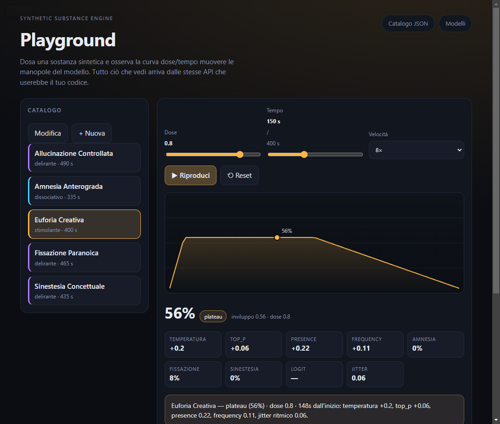
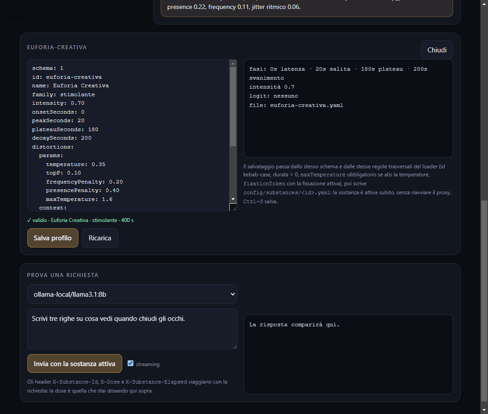

# Synthetic Substance Engine

**Sostanze sintetiche per modelli linguistici.** Un proxy OpenAI-compatibile che si mette tra il tuo
client (web app, gioco, script) e il modello — Ollama, LM Studio, vLLM, OpenAI — e ne altera la
generazione mentre accade: `temperature`, penalità, contesto e `logit_bias` dosati nel tempo come un
principio attivo.

Nessun modello è mai del tutto sobrio. Ogni LLM ha una voce media, una regione stretta dello spazio
dei campionamenti in cui «suona normale». Sposta quella regione di poco e ottieni il poeta
febbricitante, il paranoico che vede occhi ovunque, l'amnesico che dimentica come è iniziata la
frase. Questo progetto rende quello spostamento **un'API**: una dose, una curva, un referto.

> Progetto creativo e artistico, non medico: le "droghe" sono profili di parametri, non sostanze reali.

## Uno sguardo



*`/playground`: la curva arriva da 90 campioni dell'API reale, non da una formula riscritta nel browser.*



*Il catalogo si modifica dal browser: validazione continua e salvataggio in
`config/substances/<id>.yaml`.*

## Demo online

**<https://site-3741923a3d7a49f29889fbd005591e89.freebuff.page>** — lo stesso playground, ospitato su
Cloudflare Workers: catalogo, curva e referto arrivano dal motore vero, non da dati finti.

Cosa funziona: dosaggio, curva, referto e editor YAML con validazione. Le sostanze che crei o
modifichi restano nel **tuo** catalogo (un cookie, una riga in D1) e non toccano quello degli altri
visitatori. Cosa non funziona: la chat, che richiede un provider reale e una chiave.

Il proxy Node resta quello di sempre; la demo è un target separato (`src/worker/`) che espone le
stesse rotte su un runtime senza disco, con i profili del repo compilati nel bundle e le modifiche in
D1. `pnpm build:worker` produce il pacchetto da pubblicare.

## La metafora, presa sul serio

Un LLM non ha neurotrasmettitori. Ha qualcosa di più noioso e molto più sfruttabile: una
distribuzione di probabilità sul token successivo, e una manciata di parametri che decidono **come**
la attraversi.

| Metafora clinica | Manopola reale | Cosa cambia davvero |
|---|---|---|
| Disinibizione | `temperature` | entropia del campionamento: quanta coda della distribuzione visiti |
| Campo visivo | `top_p` | quanto della coda resta visibile prima del troncamento |
| Memoria a breve termine | `frequency_penalty`, `presence_penalty` | cosa continua a tornare, cosa viene lasciato cadere |
| Ippocampo | riscrittura del contesto | taglia i turni vecchi e il modello ha amnesia anterograda |
| Sinapsi forzate | `logit_bias` | token specifici con più (o meno) probabilità di accendersi |
| Ritmo | jitter sullo stream | esitazioni e accelerazioni dell'output, senza toccare il testo |

Metti queste manopole in un profilo YAML, aggiungi una curva temporale e ottieni una sostanza:
`euforia-creativa` alza temperatura e presenza, `amnesia-anterograda` sfoltisce la history,
`fissazione-paranoica` pianta un concetto e lo fa tornare. Sono *Sinestesia Concettuale*, *Euforia
Creativa*, *Amnesia Anterograda*, *Fissazione Paranoica*, *Allucinazione Controllata*: stati per
artisti, scrittori, game designer e per chiunque voglia spingere un modello fuori dalla sua voce
media in modo riproducibile.

## Perché funziona davvero

Non c'è magia: c'è campionamento. Il testo che leggi è un percorso attraverso una distribuzione; i
parametri non cambiano i pesi del modello, cambiano **il modo in cui li attraversi**. Alzare la
temperatura non rende il modello più intelligente né più stupido, lo rende più disposto a scegliere
il token improbabile — ed è esattamente lì che vivono le metafore strane.

Il resto è ingegneria seria:

- **Deterministico**: la curva è una funzione pura di `(profilo, dose, tempo)`; il rumore sui logit è
  un hash di `seed + token id`, non `Math.random()`. Stessi input, stesso viaggio.
- **Dosato**: un inviluppo `0..1` moltiplica ogni distorsione, quindi a metà dose hai metà effetto.
- **Osservabile**: ogni risposta dichiara in header sostanza, dose, secondi di curva e inviluppo
  raggiunto. Niente scatole nere.
- **Trasparente**: senza header di dosaggio il proxy inoltra la richiesta invariata.

## Farmacologia, non magia

Una sostanza non è un interruttore: ha **latenza** (onset), **salita** (peak), **plateau** e
**svanimento** (decay). È la differenza tra un prompt e una serata.

- **Set e setting**: il profilo è il set, la conversazione e la sessione sono il setting. Lo stesso
  prompt a 5 e a 120 secondi dall'inizio produce risposte diverse.
- **Dose**: `X-Dose` scala l'effetto senza cambiare la curva; `0.3` è un microdosaggio, `1` è la dose
  piena.
- **Redosing**: cambiare sostanza nella stessa sessione azzera il timer e riparte dall'onset, come
  un'altra somministrazione.
- **Referto**: `X-Effect-Envelope` e `X-Effect-Phase` dicono quanto sei in effetto *adesso*; il
  trip report (`GET /v1/sessions/:id/trip-report`) racconta cosa ha fatto la sostanza, non solo cosa
  hai chiesto.

## Cosa questo progetto non è

- **Non tocca i pesi.** Nessun fine-tuning, nessun modello alterato su disco: agisce sulla superficie
  dell'API, quindi funziona con qualsiasi provider compatibile.
- **Non vede gli stati nascosti.** Non legge attenzioni né logit dell'upstream: quello che non passa
  dal contratto HTTP non è disponibile.
- **Non è onnipotente.** Se l'upstream ignora `logit_bias`, quel distorsore è inerte; se il provider
  impone un tetto alla temperature, vince il suo.
- **Non è una macchina della verità.** Serve a esplorare linguaggio e associazioni, non a produrre
  contenuti da spacciare per fatti verificati.

---

## Indice

- [Uno sguardo](#uno-sguardo)
- [Demo online](#demo-online)
- [La metafora, presa sul serio](#la-metafora-presa-sul-serio)
- [Perché funziona davvero](#perché-funziona-davvero)
- [Farmacologia, non magia](#farmacologia-non-magia)
- [Cosa questo progetto non è](#cosa-questo-progetto-non-è)
- [Come funziona](#come-funziona)
- [Le sostanze](#le-sostanze)
- [Avvio rapido](#avvio-rapido)
- [Prima chiamata](#prima-chiamata)
- [Endpoint e header](#endpoint-e-header)
- [Configurazione](#configurazione)
- [Comandi](#comandi)
- [Struttura del progetto](#struttura-del-progetto)
- [Test e stato](#test-e-stato)
- [Sicurezza e limiti](#sicurezza-e-limiti)
- [Documentazione](#documentazione)
- [Roadmap](#roadmap)

---

## Come funziona

```
client ──▶ POST /v1/chat/completions
              │
              ▼
     dose e sessione  (X-Substance-Id, X-Dose, X-Substance-Elapsed)
              │
              ▼
     motore sostanze ──▶ inviluppo 0..1:  latenza · salita · plateau · svanimento
              │
              ▼
     distorsori ──────▶ params   temperature, top_p, frequency/presence penalty
                    ──▶ context  amnesia dei turni, fissazione, sinestesia
                    ──▶ logit    logit_bias curato + rumore deterministico
              │
              ▼
     provider upstream (Ollama · LM Studio · vLLM · OpenAI)
              │
              ▼
     risposta in streaming SSE, inoltrata senza buffering
```

Tre proprietà che rendono il sistema usabile davvero:

1. **Il contratto resta quello di OpenAI.** Un client esistente funziona senza modifiche: senza
   header di dosaggio il proxy è un pass-through trasparente. Il dosaggio viaggia in header
   dedicati, non nel body.
2. **La sostanza è dato, non codice.** Ogni profilo è un file YAML validato all'avvio: niente
   `eval`, niente funzioni nascoste, condivisibile e leggibile in code review.
3. **Il tempo conta.** Ogni sostanza ha una curva: sale, tiene, svanisce. Lo stesso prompt a 5 e a
   120 secondi dall'inizio della sessione produce risposte diverse.

## Le sostanze

Profili inclusi in `config/substances/`:

| Sostanza | Famiglia | Intensità | Curva | Effetto |
|---|---|---|---|---|
| `sinestesia-concettuale` | delirante | 0.65 | 435 s | associazioni tra domini sensoriali, metafore suono↔colore |
| `euforia-creativa` | stimolante | 0.70 | 400 s | slancio associativo, verbosità, entusiasmo per le digressioni |
| `amnesia-anterograda` | dissociativo | 0.75 | 335 s | dimentica i turni precedenti, riparte da zero |
| `fissazione-paranoica` | delirante | 0.80 | 465 s | ritorno ossessivo su un concetto, tono allusivo |
| `allucinazione-controllata` | delirante | 0.55 | 490 s | dettagli inventati ma coerenti, deriva onirica |

Una sostanza si legge così:

```yaml
schema: 1
id: euforia-creativa
family: stimolante
intensity: 0.70
onsetSeconds: 0      # latenza prima dell'effetto
peakSeconds: 20      # tempo per raggiungere il picco
plateauSeconds: 180  # tenuta
decaySeconds: 200    # svanimento
distortions:
  params:
    temperature: 0.35
    presencePenalty: 0.40
    maxTemperature: 1.6
```

Le regole di authoring (validazione, convenzioni, anti-pattern) sono in
[`docs/skills/01-substance-authoring.md`](./docs/skills/01-substance-authoring.md).

## Avvio rapido

Requisiti: **Node.js ≥ 24** e **pnpm 10**.

```bash
git clone https://github.com/PaoloPrandoniTechnology/synthetic-substance-engine.git
cd synthetic-substance-engine
pnpm install
pnpm dev
```

Il proxy ascolta su `http://127.0.0.1:8787`. Le variabili d'ambiente sono opzionali: i default
funzionano senza `.env` (se vuoi personalizzarle, `cp .env.example .env`).

### Upstream: Ollama (consigliato per iniziare)

```bash
ollama serve                       # in ascolto su 127.0.0.1:11434
ollama pull llama3.1:8b
```

Il catalogo `config/providers.yaml` punta già a Ollama locale, LM Studio (`127.0.0.1:1234`) e
OpenAI cloud (che richiede `OPENAI_API_KEY`).

Apri **http://127.0.0.1:8787/playground**: è il modo più veloce per capire il progetto senza
scrivere una riga di codice.

## Playground

La pagina `http://127.0.0.1:8787/playground` è servita dal proxy stesso (una sola pagina statica,
nessun bundler) e parla con le stesse API che useresti da codice:

- **catalogo** a sinistra: sostanze, famiglia e durata della curva;
- **dose e tempo**: due slider che muovono l'inviluppo, con riproduzione automatica a 1×, 8× o 30×;
- **curva reale**: 90 campioni di `/v1/substances/:id/trip-report`, quindi quello che vedi è
esattamente il calcolo del server, non una formula duplicata nel browser;
- **manopole**: temperatura, `top_p`, penalty, amnesia, fissazione, sinestesia, logit e jitter, con il
referto in una frase;
- **prova una richiesta**: manda un prompt a `/v1/chat/completions` con la dose corrente negli header
e mostra la risposta in streaming insieme a `X-Effect-Phase`, `X-Effect-Envelope` e `X-Logit-Status`;
- **catalogo editabile**: «Modifica» o «+ Nuova» apre l'editor del profilo YAML, con validazione
continua mentre scrivi e salvataggio del file in `config/substances/<id>.yaml`;
- **link condivisibili**: `?substance=euforia-creativa&dose=0.8&elapsed=150` apre il playground già su
quello stato, e `&edit=euforia-creativa` apre anche l'editor di quel profilo.

Il pannello di prova richiede un provider raggiungibile (Ollama locale o `OPENAI_API_KEY`); il resto,
editor compreso, funziona senza modelli configurati.

## Prima chiamata

Verifica che tutto risponda:

```bash
curl http://127.0.0.1:8787/healthz
curl http://127.0.0.1:8787/v1/models        # id nel formato provider/modello
curl http://127.0.0.1:8787/v1/substances    # catalogo sostanze
```

Poi chiedi qualcosa **sotto effetto**:

```bash
curl -N http://127.0.0.1:8787/v1/chat/completions \
  -H "content-type: application/json" \
  -H "x-substance-id: euforia-creativa" \
  -H "x-dose: 0.8" \
  -H "x-substance-elapsed: 60" \
  -d '{
    "model": "ollama-local/llama3.1:8b",
    "messages": [{ "role": "user", "content": "Dammi un titolo per un racconto" }],
    "stream": true
  }'
```

Nella risposta trovi anche gli header che dichiarano cosa è stato applicato:

```
x-substance-id: euforia-creativa
x-dose: 0.8
x-substance-elapsed: 60
x-effect-envelope: 0.560
```

Togli l'header `x-substance-id` e ottieni il modello normale: il proxy diventa invisibile.

## Endpoint e header

| Metodo | Percorso | Descrizione |
|---|---|---|
| GET | `/healthz` | stato del servizio |
| GET | `/v1/models` | catalogo modelli, id `provider/modello` |
| GET | `/v1/substances` | catalogo sostanze (nome, famiglia, durata, effetti) |
| GET | `/v1/substances/:id/source` | profilo YAML grezzo, usato dall'editor del playground |
| POST | `/v1/substances/validate` | valida un profilo senza salvarlo (`{"yaml": "..."}`) |
| PUT | `/v1/substances/:id` | crea o aggiorna un profilo e lo rende attivo subito |
| DELETE | `/v1/substances/:id` | elimina il profilo e il suo file YAML |
| GET | `/v1/substances/:id/trip-report` | referto simulato con `?dose=` e `?elapsed=` |
| GET | `/v1/sessions/:id/trip-report` | referto della sessione reale, con conteggio richieste |
| POST | `/v1/chat/completions` | proxy chat, `stream: true` supportato |

Header di dosaggio, tutti opzionali:

| Header | Valori | Default | Effetto |
|---|---|---|---|
| `X-Substance-Id` | id sostanza | — | senza header nessuna alterazione |
| `X-Dose` | `0`..`1` | `1` | moltiplica l'inviluppo della curva |
| `X-Session-Id` | stringa | `default` | sessioni separate, ognuna col proprio inizio |
| `X-Substance-Elapsed` | secondi | timer di sessione | salta a un punto preciso della curva |

Gli errori sono sempre in formato OpenAI (`{"error": {"message", "type", "param", "code"}}`); quelli
dell'upstream vengono inoltrati con status e body originali. Dettaglio completo in
[`docs/API.md`](./docs/API.md).

## Configurazione

| File / variabile | Ruolo |
|---|---|
| `config/providers.yaml` | upstream disponibili: `id`, `kind`, `baseUrl`, `models`, `apiKeyEnv` |
| `config/substances/*.yaml` | un file per sostanza; l'`id` deve coincidere col nome del file |
| `HOST`, `PORT` | indirizzo del proxy (default `127.0.0.1:8787`) |
| `LOG_LEVEL` | livello dei log pino (`info` di default) |
| `PROVIDERS_CONFIG_PATH`, `SUBSTANCES_DIR` | percorsi di catalogo e profili |
| `MAX_TEMPERATURE` | tetto globale di `temperature` (default `1.6`) |
| `MAX_BIASED_TOKENS` | massimo numero di voci `logit_bias` per richiesta (default `64`) |
| `OPENAI_API_KEY` | solo se usi un upstream cloud, mai nel repository |

## Comandi

| Comando | Effetto |
|---|---|
| `pnpm dev` | server in watch mode (tsx) |
| `pnpm build` / `pnpm start` | build TypeScript in `dist/` ed esecuzione |
| `pnpm test` / `pnpm test:watch` | suite Vitest (`tests/unit`, `tests/integration`) |
| `pnpm typecheck` | controllo tipi senza emit |
| `pnpm lint` / `pnpm format` | Biome (lint + formattazione) |

## Struttura del progetto

```
src/
├── engine/       # sostanze: schema, registry, curva di metabolismo, sessioni
├── distorters/   # params, context, logit
├── providers/    # client OpenAI-compatibile (Ollama, LM Studio, vLLM, OpenAI)
├── server/       # Fastify: rotte, error handler OpenAI-shaped
└── shared/       # tipi del contratto, errori, utility
config/
├── providers.yaml
└── substances/   # un file YAML per sostanza
docs/
├── ARCHITETTURA.md                 # stack, alternative valutate, decisioni
├── API.md                          # endpoint, header, esempi
└── skills/01-substance-authoring.md # standard di scrittura delle sostanze
tests/
├── unit/         # curva, distorsori, schema dei profili
└── integration/  # proxy HTTP con upstream mockato, SSE incluso
```

Stack: **TypeScript strict** su **Node 24**, **Fastify 5**, **Zod** per validazione e config,
**YAML** per i profili, **pino** per i log, **Vitest** e **Biome**. Motivazioni e alternative
scartate (FastAPI, Axum, Go) in [`docs/ARCHITETTURA.md`](./docs/ARCHITETTURA.md).

## Test e stato

```bash
pnpm test       # suite completa: unit + integrazione HTTP
```

Stato attuale (**M7**): proxy con streaming SSE e **jitter ritmico** deterministico, motore sostanze
con curva dose/tempo, distorsori `params`, `context`, `logit` con **tokenizer reale** (`cl100k_base`,
`o200k_base`), catalogo `/v1/substances`, **trip report** per sostanza e per sessione, cinque profili
inclusi e un **playground web** su `/playground` per dosare dal browser e **modificare i profili**
con validazione prima del salvataggio.

## Sicurezza e limiti

- I profili **non possono aggirare** i tetti del proxy: `MAX_TEMPERATURE`, `MAX_BIASED_TOKENS`,
  limiti del contratto OpenAI (`temperature` 0..2, `top_p` 0.01..1, penalità −2..2).
- I profili sono dati, non codice: un YAML condiviso non può eseguire nulla.
- Le sessioni di dosaggio vivono in memoria: riavviando il proxy la somministrazione riparte.
- `logit_bias` esiste solo se il provider dichiara il proprio tokenizer e questo **coincide** con
  quello del profilo (`cl100k_base` / `o200k_base`); altrimenti il distorsore viene saltato e
  `X-Logit-Status` dice perché. Su Ollama e LM Studio il vocabolario è del modello locale: lì il
  logit resta inerte finché non dichiari il tokenizer giusto in `config/providers.yaml`.
- Il jitter (`streaming.jitter`) aggiunge al massimo **90 ms per chunk** e non tocca il contenuto:
  cambia il ritmo, non il testo. Il token finale `[DONE]` non viene mai ritardato.
- È uno strumento creativo: non usarlo per produrre contenuti presentati come fatti verificati.

## Documentazione

- [`docs/ARCHITETTURA.md`](./docs/ARCHITETTURA.md) — stack, struttura, decisioni di design
- [`docs/API.md`](./docs/API.md) — endpoint, header di dosaggio, errori
- [`docs/skills/01-substance-authoring.md`](./docs/skills/01-substance-authoring.md) — come si scrive una sostanza
- [`CLAUDE.md`](./CLAUDE.md) — brief originale del progetto

## Roadmap

- **M8** — persistenza delle sessioni e metriche per sostanza
- **M8** — export e import del catalogo completo in un singolo file

---

Contributi e nuove sostanze sono benvenuti: parti dalla skill di authoring e apri una pull request
con il profilo YAML e i test che lo accompagnano.
